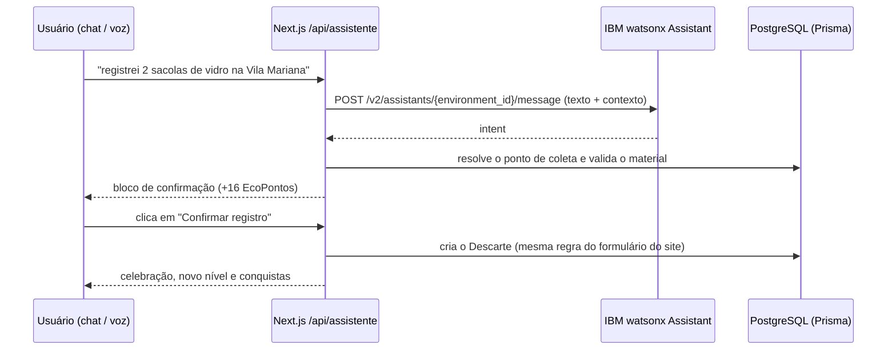

# Eco: assistente virtual do ReUse! com IBM Watson

O **Eco** é o chatbot da plataforma ReUse!, construído com o **IBM watsonx Assistant** (antigo Watson
Assistant). Ele tem dois focos:

1. **Execução de tarefas na plataforma:** registrar e desfazer descartes, buscar pontos de coleta perto
   do usuário, favoritar e remover materiais, cadastrar materiais no catálogo e consultar EcoPontos,
   missão do dia, ranking e histórico. Também abre páginas por comando.
2. **Orientação ao usuário:** passo a passo de como registrar descartes, sugerir pontos, cadastrar
   materiais, ganhar EcoPontos e conquistas, separar cada tipo de material, usar a localização e gerenciar
   a conta.

## Arquivos desta pasta

| Arquivo | Conteúdo |
| --- | --- |
| `reuse-assistente-dialog.json` | **Skill pronta para importar** no watsonx Assistant (intenções, entidades e diálogo) |
| `fonte/intencoes.ts` | 29 intenções com mais de 230 exemplos de treino em português |
| `fonte/entidades.ts` | Entidades `@material`, `@pagina`, `@ponto`, `@item`, `@tipo_ponto` e `@sys-number` |
| `fonte/dialogo.ts` | Fluxo de diálogo: nós de tarefa com *slots* e nós de orientação |
| `gerar-skill.ts` | Converte as fontes no JSON importável (`npm run assistente:gerar`) |

A skill é mantida como código, que é mais fácil de revisar e versionar, e o JSON é gerado a partir dele.

## Como funciona a integração



- O **Watson** interpreta a frase (intenção e entidades), conduz o diálogo e coleta os dados que faltam
  por meio de *slots*. Quando a tarefa está completa, responde com um `user_defined`, por exemplo
  `{ "acao": "registrar_descarte", "categoria": "VIDRO", "quantidade": 2, "ponto": "..." }`.
- O **backend do ReUse!** (`src/assistente/acoes.ts`) executa a ação no banco em nome do usuário
  logado. Ações que gravam dados pedem **confirmação** antes.
- A API v2 é usada no modo **stateless**: o contexto do diálogo vai e volta a cada mensagem. Depois de
  executar uma tarefa, as variáveis dos slots são limpas para a próxima começar do zero.
- **Fallback:** sem as variáveis `WATSON_*`, ou se a IBM estiver indisponível, o app usa
  `src/assistente/motor-local.ts`. Esse motor interpreta **este mesmo JSON**, então o comportamento é
  equivalente. O selo no topo do chat mostra qual motor está ativo: "IBM Watson" ou "modo local".

## Passo a passo: configurar no IBM Cloud

### 1. Criar a instância (plano Lite, gratuito)

1. Entre em [cloud.ibm.com](https://cloud.ibm.com) e abra o **Catálogo**.
2. Busque por **watsonx Assistant**, escolha o plano **Lite (gratuito)** e a região mais próxima (por
   exemplo, *Dallas* ou *São Paulo*, se disponível).
3. Clique em **Criar**.

### 2. Anotar as credenciais

Na página da instância (**Resource list → watsonx Assistant**), abra **Manage / Gerenciar**:

- **API key** → vai em `WATSON_APIKEY`
- **URL** → vai em `WATSON_URL` (ex.: `https://api.us-south.assistant.watson.cloud.ibm.com/instances/xxxx`)

### 3. Criar o assistente e importar a skill

1. Clique em **Launch watsonx Assistant** e crie um assistente chamado **Eco**, em português.
2. No menu lateral, abra **Assistant settings** e ative o recurso **Dialog** (*Activate dialog*).
3. Abra **Dialog → Dialog settings → Upload / Download** e envie o arquivo
   `watson/reuse-assistente-dialog.json`.
4. Espere o treinamento terminar e teste pelo botão **Preview**: *"quero registrar um descarte"*.

> **Experiência clássica:** em *Skills → Create skill → Dialog skill → Upload skill*, importe o mesmo
> JSON, adicione a skill a um assistente e use o **Assistant ID** em `WATSON_ASSISTANT_ID`.

### 4. Pegar o ID do ambiente

Em **Environments → Draft** (ou *Live*), clique na engrenagem **⚙ Settings** e copie o
**Environment ID** → vai em `WATSON_ENVIRONMENT_ID`.

### 5. Configurar o projeto

No `.env` do backend, ou em **Environment** no Render:

```env
WATSON_APIKEY="sua-api-key"
WATSON_URL="https://api.us-south.assistant.watson.cloud.ibm.com/instances/xxxx"
WATSON_ENVIRONMENT_ID="id-do-ambiente"
```

Reinicie o servidor (ou faça um novo deploy). O selo do chat passa a mostrar **IBM Watson**.

## Alterar o assistente

1. Edite os arquivos em `watson/fonte/`.
2. Rode `npm run assistente:gerar` para gerar o JSON.
3. Rode `npm run assistente:testar` para validar a classificação e os fluxos.
4. Importe o JSON novamente no watsonx Assistant.
